

<a href="https://moertendorferlukas.github.io/">
  
</a>

  

**Servus!** I'm Lukas, 19, in my final year of computer science at **HTL Leonding** in Austria. 
I turn ideas into working code: web apps, everyday tools and a growing pile of browser games.

No JavaScript runs in a GitHub README. Every 3D scene on this page is a pure SVG, pre-rendered frame by frame with my own little <a href="tools/gen.py">Python renderer</a>.

  

<a href="https://moertendorferlukas.github.io/zweiSpieler.html"></a>
<a href="https://moertendorferlukas.github.io/BlackJacKing/"></a>
<a href="https://play.dungeonfighters.me"></a>

  

<a href="https://moertendorferlukas.github.io/#spiel">
  
</a>

  

<table>
  <tr>
    <td width="33%" align="center" valign="top">
      <a href="https://moertendorferlukas.github.io/dinoGoesFishing.html">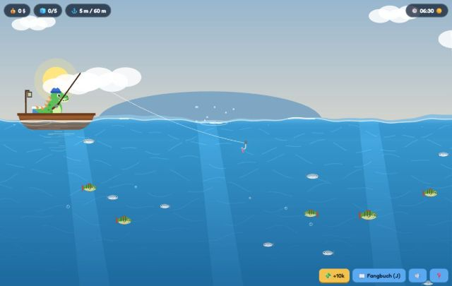</a> 
      <b>Dino Angler</b> 
      Catch fish, upgrade rod and boat, fish down to the deep-sea trench and find seven secrets.
    </td>
    <td width="33%" align="center" valign="top">
      <a href="https://moertendorferlukas.github.io/spiderDinoGame.html">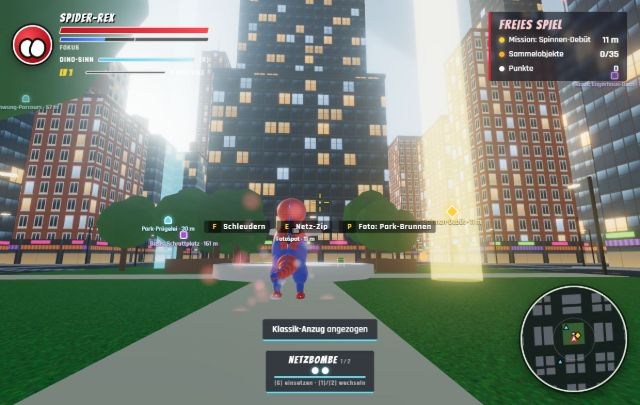</a> 
      <b>Spider-Rex</b> 
      A dino in a spider suit swings through a 3D city. Built with three.js.
    </td>
    <td width="33%" align="center" valign="top">
      <a href="https://moertendorferlukas.github.io/dinoWeitwurf.html">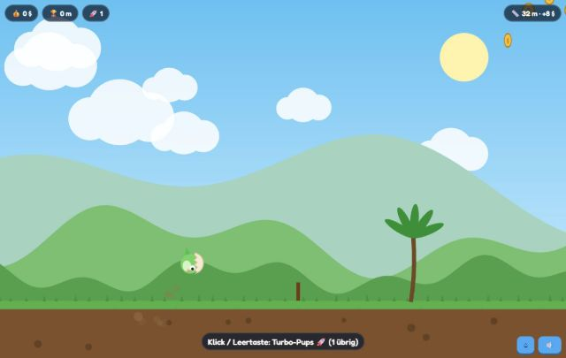</a> 
      <b>Dino Toss</b> 
      Papa Rex flings his baby as far as he can. Mushrooms and geysers help, man-eating plants don't.
    </td>
  </tr>
  <tr>
    <td width="33%" align="center" valign="top">
      <a href="https://moertendorferlukas.github.io/mampfosaurus.html">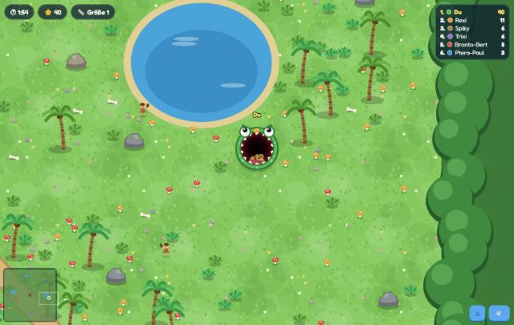</a> 
      <b>Mampfosaurus</b> 
      A giant mouth devours the prehistoric land, from eggs to mammoths, against five hungry rivals.
    </td>
    <td width="33%" align="center" valign="top">
      <a href="https://moertendorferlukas.github.io/dinoPirat.html">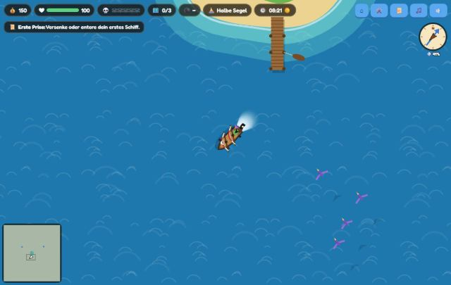</a> 
      <b>Captain Rexbeard</b> 
      A T-Rex as a pirate: sail with the wind, fire broadsides, win sabre duels, piece together treasure maps.
    </td>
    <td width="33%" align="center" valign="top">
      <a href="https://moertendorferlukas.github.io/geheimnisse.html">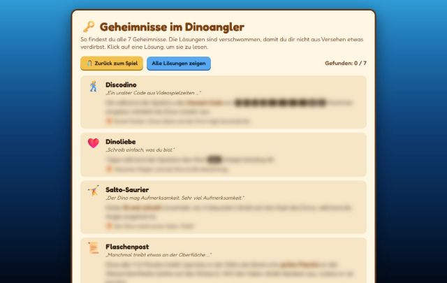</a> 
      <b>Secrets</b> 
      Stuck? The solutions to all seven secrets hidden in Dino Angler.
    </td>
  </tr>
</table>

 


  

<a href="https://moertendorferlukas.github.io/#kontakt">
  
</a>

  

&nbsp;

